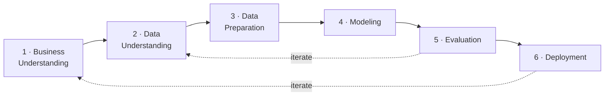

# Cosmetics Catalog Data Explorer

Structured product data extracted from Brazilian cosmetics catalogs
(**O Boticário · Natura · Eudora · Avon · Jequiti**) plus an ML portfolio
analysis of pricing, promotion and assortment.

**Live:** https://arturovaine.com/cosmetics-catalogs.html

- 112 catalogs · 5 brands · 2025–26
- 116,234 product records → 114,323 priced rows → **25,180 unique products**
- k-means clustering into **four behavioural archetypes**

## CRISP-DM

The project follows the six phases of CRISP-DM (Cross-Industry Standard Process
for Data Mining) — iteratively, not linearly (evaluation kept looping back into
the data and the model):

| Phase | In this project |
|---|---|
| **1. Business Understanding** | Framed for an RGM / pricing manager: how do rival brands run assortment, price and promotion across cycles? |
| **2. Data Understanding** | 112 public catalogs (5 brands, 2025–26) as images/PDFs; map coverage, gaps and quirks (non-chronological cycles, price-less items). |
| **3. Data Preparation** | Vision/LLM extraction turns pages into rows; clean (price R$3–2,000) and engineer five behavioural features per unique product. |
| **4. Modeling** | k-means on standardized features; k chosen by silhouette (= 4); PCA for the 2-D map. |
| **5. Evaluation** | Silhouette, a feature-robustness check (Adjusted Rand Index), and a sanity read of each archetype against the business questions. |
| **6. Deployment** | The live explorer: data table, ML tab, animations, filters, downloadable CSVs. |

## The five features (per unique product)

Clustering is **behaviour-based** (not category/brand): aggregate every catalog
appearance of a product, then describe it with

| Feature | Formula | Captures |
|---|---|---|
| `log_price` | ln(median regular price) | price tier |
| `promo_rate` | mean of `promotion_active` | promo exposure (0–1) |
| `med_discount` | median discount % when promoted | markdown depth |
| `log_appearances` | ln(number of appearances) | persistence |
| `price_cv` | std ÷ median of price, clipped [0,1] | price volatility |

A robustness check (`analysis/feature_experiments.py`) confirms the archetypes
are driven by the promotion/discount axis and survive behavioural tweaks; adding
brand or category just makes k-means re-describe brand/category (ARI ≈ 0.01).

## Analysis scripts

| Script | Purpose |
|---|---|
| `analysis/cluster_portfolio.py` | the clustering (5 features, k-means, PCA, charts) |
| `analysis/arch_anim_data.py` | cumulative architecture-map animation data |
| `analysis/kmeans_anim_data.py` | Lloyd-iteration (k-means convergence) animation data |
| `analysis/method_figures.py` | per-section methodology figures |
| `analysis/feature_experiments.py` | feature-set robustness check (ARI) |

> The page itself lives in the portfolio repo (`arturovaine.github.io`,
> `cosmetics-catalogs.html`); this repo holds the analysis and data, and its
> `index.html` redirects to the live page.
